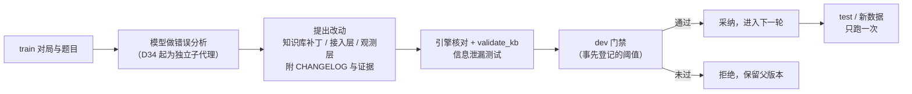

# 知识库综合评估：做题与对局、模型管理的迭代

> 日期 2026-11-24（太平洋时间）。综合 D31–D38 的全部数据，不新增任何模型调用。
> 逐阶段题目结果由 `python -m scripts.kb_iteration_summary` 从原始数据重新计算（`reports/bench/kb_iteration_stages.md`）；
> 跨模型与对局的全口径表见 `reports/bench/d38_posthoc.md`；对局数字另引自各期报告。
> **证据等级**：标"登记"的是事先登记、只跑一次的主结果；标"事后"的是看过结果之后的合并或检验，只作探索性证据。
> 模拟器内结果，不进强度验收（D1）。

## 0. 结论

**总的说法**（每一句都有登记过的数据支撑，偏离之处一并写明）：

> 经过模型管理的多轮迭代，知识库从"接入无效"变为**显著提高模型对规则的掌握**：
> 在只跑一次的保留题上，DeepSeek 的情境规则题正确率提高 11 个百分点（0.812 → 0.923；新数据 0.746 → 0.856），均 p < 0.001。
> **提升随模型变强而减小**：较弱的 GLM-4.7-Flash +21.8 个百分点，DeepSeek +11.8，接近满分的 Sonnet 没有提升。
> 在对局中，DeepSeek 带知识库的四次独立评测**方向都为正**（+0.02 ~ +0.07），但单次都不显著；两次镜像对战事后合并为 0.539（p = 0.044）。
> 小模型的对局没有提升，这是与预期不符的部分。

| 预期 | 做题（规则知识） | 对局 | 判断 |
|---|---|---|---|
| ① 知识库有正提升 | **支持**：test +0.112、新数据 +0.110、GLM +0.218，均登记、p < 0.001 | **部分支持**：DeepSeek 4/4 次方向为正，单次不显著；事后合并 p = 0.044 | 做题确定；对局是小幅、方向一致的正效应 |
| ② 对较弱模型提升显著 | **支持**：GLM-4.7-Flash +0.218（p < 0.001），比 DeepSeek 多 +0.100 [+0.031, +0.168]（事后，p = 0.0002） | **不支持**：GLM-4-Flash 0.400、Decision 1 0.460，都不显著 | 做题成立，对局偏离 |
| ③ 对强模型不显著甚至为负 | **支持**：Sonnet 0.98 → 0.95（0 / 3，不显著，方向为负） | 无强模型对局数据 | 做题成立 |
| ④ 迭代相比初始逐阶段进步 | **支持**：直接作答 −0.033 → +0.044；先写依据 +0.029 → +0.112（test）；斩杀从显著有害（−0.064）修复到持平 | **部分支持**：对脚本对手 +0.030 → +0.074（不显著）；观测层改进显著（0.584，p = 0.010） | 接入层与观测层的改进有效；内容补丁都未通过门禁 |

**偏离与原因**：
- **知识没有转化为对局胜率**：知识库补的是规则事实，对局的胜负更多取决于取舍与时机。D37 的派生事实让模型更贪伤害，但没有赢更多（D37 §8）。
- **小模型对局反而不升**：小模型带知识库后提示长了一倍（GLM-4-Flash 每次决策 2,427 对 1,233 token），可能稀释了对局面的注意力；这是推测。
- **"弱模型提升更多"主要来自提升空间**：按补上的空间比例（差 ÷（1 − 不带知识库的正确率）），GLM 0.38、DeepSeek 0.44，相近。

## 1. 数据范围

| 期 | 模型 | 做题 | 对局 | 用途 |
|---|---|---|---|---|
| D31 | DeepSeek-V4.1-Flash | 规则题 56；斩杀 v1 52 | `lite`（对脚本对手）2 轮 | 起点：接入层诊断 |
| D32 | DeepSeek | 情境题 train / dev 245 / test 260；斩杀 dev 64、test 70 | `lite` test | S0–S5 分阶段 |
| D33 | DeepSeek；GLM-4.7-Flash | 情境题 v3 新数据 1151（GLM：test 子集 390） | `lite_fresh` | 候选 C1–C3、跨模型 |
| D34 | DeepSeek | 情境题 dev、斩杀 dev（守门） | 镜像 dev 80 对 | 教师补丁 v1.1 / v1.2 / s1 |
| D35 | DeepSeek | 情境题、斩杀（守门） | — | 教师管线；观测层 `elements=1` |
| D36 | DeepSeek | 守门 | 镜像 dev、test 150 对 | 三轮进化 R1–R3；观测层 |
| D37 | DeepSeek；GLM-5.3-Flash | 斩杀、机制核对 | 镜像 dev 40 对；跨模型 | 派生事实、角色卡、评测指标 |
| D38 | GLM-4-Flash、Gemini Decision 1、Sonnet 子代理 | Sonnet：情境 100、斩杀 64 | 镜像 dev 各 50 对 | 小模型 |

## 2. 模型管理的迭代过程

### 2.1 流程



- 改动由模型提出：Claude 担任教师，在 train 数据上做错误分析、写补丁和证据；D34 起由两个互不知情的子代理各看一半 train 对局，只采纳两边都独立出现的模式。
- 是否采纳**不由提出改动的模型决定**：每一期的门禁、阈值和 test 规则都事先登记，只追加。
- 教师只看 train；dev 只看汇总数字；test 和新数据每期只跑一次。

### 2.2 各轮提案与门禁结果

| 期 | 模型发现的问题（train） | 提出的改动 | 门禁结果 | 采纳 |
|---|---|---|---|---|
| D31 | 中文检索 56 题命中 0；4,350 个决策只用到 90 节规则中的 11 节 | 诊断，未改 | — | — |
| D32 | 规则节"给不到、给错、给了不用" | S1 BM25 检索 | dev −0.031（p = 0.027） | 否 |
| | | S2 剪掉过宽的策略单元 | 噪声内 | 否 |
| | | S3 斩杀窗口定向资料 | 噪声内 | 否 |
| | | **S4 按可见局面触发规则节** | 情境 dev +0.053（p = 0.018） | **是** |
| | | **S5 = S4 + 先写依据** | 斩杀 dev 4 / 0；test 情境 +0.112 | **是** |
| D33 | "下回合先手"规则从未被注入 | C1 只留规则 | 斩杀 −0.039 | 否 |
| | | **C2 加先手触发（`kbt3-trig`）** | 新数据情境 +0.110；先手题 0.154 → 0.958 | **是** |
| | | C3 检查清单式回复 | 斩杀 −0.016 | 否 |
| D34 | 规则节被截断到 420 字，附着转移表丢了四行 | 规则卡 v1.1 / v1.2（引擎核对全部一致） | 情境 dev −0.016，阈值 −0.01 | 否 |
| | 子代理归纳的打法模式 | 策略层 v1.0-s1 | 对 v1.0 0.475 | 否 |
| D35–D36 | 状态文本不写元素，模型重投时猜错（两个子代理都发现） | **观测层 `elements=1`** | 镜像 80 对 **0.584，p = 0.010** | **是** |
| D36 | 带骰结束、不放爆发 | R1 v1.0-s2 | 情境守门 −0.026 | 否 |
| | | R2（修复 R1 的守门问题） | dev 0.450 | 否 |
| | 换掉核心牌 | R3 v1.0-s3 | 机制核对通过；dev 0.537 < 0.55 | 否 |
| D37 | 技能伤害与反应要模型自己推算 | 派生事实 + 角色卡（预演核实 0.997，泄漏测试通过） | dev H 0.475 | 否 |

**16 项提案中采纳 4 项**：S4、S5、C2、`elements=1`。被拒的 12 项中，有 3 项机制核对通过，即确实改变了目标行为，但没有提高胜率（R2、R3、D37）。这说明门禁拦下的是"看起来合理但不提升结果"的改动。

### 2.3 固定题集上的逐阶段进步（DeepSeek）

同一批题、同样轮数、按题配对（`reports/bench/kb_iteration_stages.md`）：

| 题集 | 起点（S0 原接入） | S4 | S5（先写依据） | C2（当前） | 证据 |
|---|---|---|---|---|---|
| 情境 dev 245，直接作答 | **−0.012**（8 / 14） | +0.053（23 / 10，p = 0.018） | — | — | 登记 |
| 情境 dev 245，先写依据 | +0.053（27 / 15，p = 0.044） | — | +0.096（32 / 4） | **+0.104**（32 / 2） | 登记 |
| 情境 test 260，直接作答 | **−0.033**（10 / 21） | +0.044（19 / 8，p = 0.026） | — | — | 登记，只跑一次 |
| 情境 test 260，先写依据 | +0.029（25 / 20，p = 0.28） | — | **+0.112**（39 / 2，p < 0.001） | — | 登记，只跑一次 |
| 情境 v3 新数据 1151 | — | — | — | **+0.110**（196 / 57，p < 0.001） | 登记，只跑一次 |
| 斩杀 dev 64 | −0.016（0 / 1） | −0.023 | **+0.055**（4 / 0，p = 0.063） | +0.055（5 / 2） | 登记 |
| 斩杀 test 70 | **−0.064**（0 / 7，显著有害） | — | −0.007（4 / 4） | — | 登记，只跑一次 |
| 斩杀 v3 新数据 141 | — | — | — | −0.004（7 / 10） | 登记，只跑一次 |

数字是"该阶段 − 不带知识库"，括号为（好 / 差）与单侧 p。

- **规则知识**：起点在直接作答时为负，最终在两份只跑一次的保留数据上都是 +0.11，p < 0.001。
- **斩杀**：起点接入在 test 上显著有害（0 好 / 7 差），迭代后修复到与不带知识库持平。斩杀题不带知识库已有 0.92–0.95，提升空间很小。
- 之后几轮内容补丁（v1.1、v1.2、s1、R1–R3、D37）对当时版本的斩杀差都在 −0.047 到 +0.031 之间，没有一项显著。

### 2.4 对局上的阶段结果（DeepSeek，引自各期报告）

| 阶段 | 比较 | 结果 | 证据 |
|---|---|---|---|
| D31 起点 | 三种知识配置对不带（`lite`，2 轮平均） | +0.025 [−0.03, +0.08] | 登记 |
| D32 S0 | 原接入对不带（`lite` test） | 0.777 对 0.747，+0.030 | 登记，只跑一次 |
| D32 S5 | 对不带（同上） | **0.821 对 0.747，+0.074 [+0.007, +0.141]**，11 / 4，p = 0.118 | 登记，只跑一次 |
| D33 C2 | 对不带（`lite_fresh` 新数据） | 0.768 对 0.746，+0.022，9 / 9 | 登记，只跑一次 |
| D34 v1.0 | 镜像对战 dev 80 对 | 0.550，16 / 56 / 8，单侧 p = 0.076（报告写的 0.15 是双侧） | 登记 |
| D36 观测层 | `elements=1` 对原观测层（都不带知识库） | **0.584，23 / 48 / 9，p = 0.010** | 登记 |
| D36 v1.0 | 镜像对战 test 150 对 | 0.533，43 / 74 / 33，p = 0.151 | 登记，只跑一次 |
| D34 + D36 | 两次镜像对战合并 230 对 | **0.539，59 / 130 / 41，p = 0.044**（Stouffer 0.041–0.046） | 事后合并 |
| D37 | 派生事实 + 角色卡对当前版本 | H 0.475（40 对） | 登记 |

- DeepSeek 带知识库的四次独立对局评测（D32、D33、D34、D36）**方向都为正**，单次都不显著。
- 唯一在对局中单独显著的改进是观测层（`elements=1`）。它是模型在 train 材料中发现的问题，但它改的是状态描述，不是知识库内容。

## 3. 跨模型：提升与模型强弱

### 3.1 做题（情境规则题，先写依据）

| 模型 | 题集 | 不带知识库 | 带知识库 | 差 | 好 / 差 | p | 补上的空间比例 | 证据 |
|---|---|---|---|---|---|---|---|---|
| GLM-4.7-Flash | v3 test 390 | 0.426 | 0.644 | **+0.218** | 114 / 29 | < 0.001 | 0.38 | 登记（D33） |
| DeepSeek-V4.1-Flash | 同一批 390 | 0.733 | 0.851 | **+0.118** | 67 / 19 | < 0.001 | 0.44 | 登记（D33）；取同题子集为事后 |
| Sonnet 子代理 | dev 抽样 100 | 0.980 | 0.950 | −0.030 | 0 / 3 | 1.0 | — | 登记（D38） |
| DeepSeek | 与 Sonnet 重叠的 43 题 | 0.872 | 0.965 | +0.093 | 5 / 1 | 0.11 | — | 事后 |
| Sonnet 子代理 | 同上 43 题 | 1.000 | 0.977 | −0.023 | 0 / 1 | 1.0 | — | 事后 |

- 同一批 390 题上，GLM 的增益比 DeepSeek 大 **+0.100 [+0.031, +0.168]**，单侧 p = 0.0002（事后检验）。
- 在重叠的 43 题上，DeepSeek +0.093、Sonnet −0.023，方向与预期一致，但题少，不显著。
- 斩杀题上没有这个模式：DeepSeek −0.004（接近上限），Sonnet +0.047（5 / 2，p = 0.23）。

### 3.2 对局（镜像对战，同模型带知识库对不带）

| 模型 | 对数 | 只看胜负 | 主规则（胜利优先，平局按 K→H→D） | 生命差 H | 证据 |
|---|---|---|---|---|---|
| DeepSeek（D34 + D36） | 230 | **0.539**（p = 0.044，事后合并） | 终局未记录 | — | 登记；合并为事后 |
| Gemini Decision 1 | 50 | 0.530（p = 0.29） | 0.460（p = 0.76） | 0.460 | 登记 |
| GLM-4-Flash | 50 | 0.500（p = 0.62） | 0.400（p = 0.94） | 0.400 | 登记 |
| GLM-4-Flash，知识库 + 派生事实 | 50 | 0.550（p = 0.18） | 0.580（p = 0.16） | 0.590 | 登记（次要比较） |

对局上较弱的模型没有提升，与预期 ② 不符。GLM-4-Flash 加上派生事实后方向转正（K 击倒差 p = 0.045），但这是次要比较中的次要指标，不作结论。

## 4. 推荐的表述

**可以写**：
1. 知识库经过模型管理的迭代（16 项提案、4 项通过门禁），从起点的"接入无效、直接作答时略有害"变为显著提高规则掌握：只跑一次的保留题 +0.112、新数据 +0.110（DeepSeek），均 p < 0.001。
2. 提升随模型变强而减小：GLM-4.7-Flash +0.218、DeepSeek +0.118、Sonnet −0.03（不显著）。同题上弱模型多 +0.100（事后检验 p = 0.0002）；这主要来自提升空间。
3. 迭代修复了起点接入在斩杀题上的显著损害（−0.064 → −0.007）。
4. 对局中 DeepSeek 带知识库方向一致为正（4/4 次），合并镜像对战 0.539（事后合并 p = 0.044）；观测层改进单独显著（0.584，p = 0.010）。

**写的时候要带上的限定**：
- 第 4 条的合并是事后决定的，两次的观测层不同；单次评测都不显著。
- "弱模型提升更大"只在规则题上成立，对局上不成立（GLM-4-Flash、Decision 1 都不显著）。
- 知识库内容本身（v1.0）在迭代中没有改动：通过门禁的是接入层（触发、回复格式）与观测层；内容补丁都被拒绝。

**不能写**：
- "知识库显著提高对局胜率"（没有一次登记的对局评测显著）；
- "知识库显著提高小模型的对局胜率"（没有任何口径支持）。

## 5. 若要确认

| 目标 | 做法 | 规模与成本 |
|---|---|---|
| 规则题上"越弱提升越大" | 新生成、从未用过的情境题；事先登记；3–4 个强弱不同的模型（含 GLM-4-Flash、DeepSeek、一个强模型的 API） | 每个模型约 400 题 × 2 条件；免费档或几元钱 |
| DeepSeek 对局上的小幅正效应 | 新的镜像保留对；事先登记单次检验 | 约 700 对（按 D36 的对分均值 +0.067、标准差 0.71，单侧 α = 0.05、把握 80%），约 340 元 |

`mirror_dev200` 已经没有未用的对；对局确认需要新建锁文件。

## 6. 复现

```bash
python -m scripts.kb_iteration_summary --out kb_iteration_stages   # 固定题集上的逐阶段结果
python -m scripts.d38_posthoc_summary --out d38_posthoc             # 跨模型、对局的全口径表
```

对局阶段结果的原始命令见各期报告的"复现"一节。
